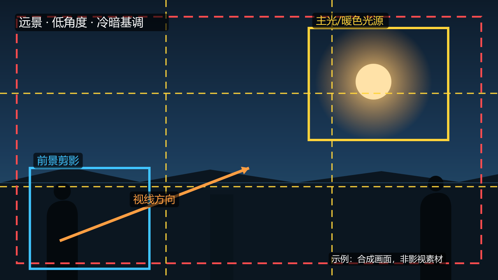

# dsh-film-analysis · 影视画面分析器（DSH 插件）

[中文](#中文) | [English](#english)

[](https://www.npmjs.com/package/dsh-film-analysis) [](LICENSE)

面向 [DeepSeek Harness](https://github.com/deepseek-ai/deepseek-harness) Web UI 的影视/视听语言分析插件：导入图片或视频，**客观测量画面指标**，按影视语言框架完成 **8 维分析**，在画面上**标注**，生成**结构化提示词**，并导出**分析报告与分镜/镜头表**。工具链（ffmpeg、ffprobe、中文 OCR）随 DSH 插件一起安装，无需另装 Python 或 ffmpeg。

> **语言 / Language**：面板界面为中英双语（跟随 DSH 语言设置）；**AI 分析输出、内置术语库与生成的提示词为简体中文**。UI is bilingual (zh/en); AI analysis output, the built-in term library and generated prompts are in **Simplified Chinese**.



## 功能

- **画面测量**：尺寸/画幅比、平均亮度、对比度(RMS)、色温倾向(R-B)、饱和度、边缘密度、16 桶直方图、主色板
- **8 维分析表单**：景别 / 景深与焦距 / 角度和机位 / 光线和影调 / 色彩色调 / 构图 / 镜头运动 / 声音线索（内置通用术语库，可替换为自己的笔记词库）
- **画面标注**：三分/黄金分割辅助线、景别框、轴线、视线/运动箭头、中文文字标签，导出 PNG
- **提示词生成**：把「图片路径 + 测量数据 + 8 维表单 + 分析框架」拼成提示词，一键填入会话输入框（或发送）
- **报告导出**：Markdown 分析报告 + 分镜/镜头表 CSV
- **视频工具**：ffprobe 元信息、按时间点/区间抽帧、多帧接触表（接触表可直接交给视觉模型看全场）
- **中文 OCR**：离线识别画面字幕/文字（tesseract.js + chi_sim），首次初始化需十余秒
- **大视频**：上传上限 8GB（流式写入，不占内存）；更大的视频可直接填绝对路径导入，走本地读取、完全不上传
- **自动拉片 + 面板内一键 AI 分析**：自动检测镜头切换（长镜头自动多帧、自动裁黑边），点任一镜头直接在面板里生成「拉片讲解式」详细分析（片段级运动/亮度/声音 + 多帧看图），可复制/重新分析；长镜头自动按 60 秒分段，可逐段分析
- **整片拉片报告**：一次模型调用输出全片分镜表 + 逐镜头讲解 + 节奏结构 + 风格主题（面板内显示，带 token 用量与费用估算）
- **按拉片公式输出**：内置「叙事顺序 / 叙事段落 / 叙事音乐」+「剪辑时长 / 剪辑规律 / 剪辑组合」六向拉片框架（参考公开教程《适合所有人的拉片公式》），并结合八维视听语言与逐帧时间线；自动统计镜头时长分布、重复节拍组合与每镜头音量/静音数据
- **更准的分析输入（可选）**：可导入 .srt/.vtt 字幕或纯文本台词，并填写影片背景/剧情/人物关系；这些作为“可信输入”进入模型，明显减少“声音/人物关系”类推测
- **更高清的分析画面**：详细模式使用 1280 宽代表帧；长镜头额外生成 2×3 时间序列接触表，一张图看完整过程
- **结果可视化**：AI 镜头分析与整片报告以 Markdown 渲染（标题/粗体/列表/表格/代码块），长文可滚动阅读
- **知识点速查**：面板内按章节查看术语、定义、两书分析框架与题库（内置从学习笔记整理的知识点总结；教材原文与完整笔记不随包分发）
- **可调参数**：自动拉片的检测灵敏度（0.10–0.60）与分析详细度（快速 / 详细），兼顾成本与速度
- **13 个 Agent 工具**：面板里的操作同时暴露为 `film_*` 工具，会话里的 AI 也能直接调用

## 安装

### 方式 D：npm 包（最省事，DSH 用户推荐）\n\n本插件已发布到 npm：**dsh-film-analysis**（https://www.npmjs.com/package/dsh-film-analysis）\n\n在 DSH 的 cordis 预设会话中对 AI 说：\n\n> 请用 plugin_manager 安装插件，install_bundle 的 target 是 dsh-film-analysis\n\n首次安装会提示批准 	esseract.js 的构建脚本（内容仅为开源项目捐赠提示，不安装任何东西，可放心允许）；工具链（ffmpeg/ffprobe/中文 OCR）会随 npm 依赖自动下载。\n\n### 方式 A：下载 Release 里的离线包（推荐，Windows x64）

1. 到 [Releases](../../releases) 下载 `dsh-film-analysis-win-x64-v0.2.0.zip`，解压到固定目录（装好后不要移动）：
   ```
   C:\Users\<你>\dsh-plugins\dsh-film-analysis
   ```
2. 确认 `pnpm --version` 可用（没有就 `npm i -g pnpm`）。
3. 在 DSH Web 新建会话，预设选 **cordis / 创造模式**，对 AI 说：
   > 请用 plugin_manager 安装插件，install_bundle 的 target 是 `C:\Users\<你>\dsh-plugins\dsh-film-analysis`
4. 出现 `application: applied` 后刷新页面：会话顶部出现「**影视画面分析**」标签，输入框下方出现窄条即为成功。

### 方式 B：从 GitHub 直接安装（适合开发者）

在 DSH 的 cordis 预设会话中：

> 请用 plugin_manager 安装插件，install_bundle 的 target 是 `github:Raven-Jackdaw/dsh-film-analysis`

需要本机有 `git` 且能访问 GitHub；首次安装会从 npm 下载工具链（约 200MB，可能需要批准依赖构建脚本）。

### 方式 C：从源码构建

```powershell
git clone https://github.com/Raven-Jackdaw/dsh-film-analysis.git
cd dsh-film-analysis
npm install --ignore-scripts            # 安装工具链依赖，约 200MB
# 然后在 DSH cordis 会话中让 AI 安装当前目录绝对路径
```

## 兼容性

- DSH Web `>=0.2.1-rc.2 <0.3.0`
- Windows x64 已验证；macOS / Linux 理论可用（ffmpeg/ffprobe 依赖包会自动选择对应平台二进制，未实测）
- 复用 DSH 自带的 `sharp`（图像处理），不额外打包 libvips

## 目录结构

```
index.js              # Host 入口：注册工具与面板 HTTP 路由
client.js             # Client 入口：conversation.view 全页 + composer.dock 窄条
cordis.patch.yml      # bundle patch（插入一行插件）
lib/                  # 工具链解析、测量、色板、图像/视频/OCR、路由、知识数据
locale/               # 插件显示元数据（zh/en）
docs/                 # README 图片与知识数据说明
```

## 知识数据说明

`lib/knowledge.js` 内置的是**通用影视语言术语与框架**（开源版），不含任何教材原文、页码或题库。
如需使用自己的教材笔记词库，按 [docs/knowledge-data.md](docs/knowledge-data.md) 的字段结构替换该文件即可（面板会自动读取）。

## License

- 本插件代码：MIT（见 [LICENSE](LICENSE)）
- 运行时依赖：ffmpeg/ffprobe 为 GPLv3 独立程序（由 npm 包按平台安装），tesseract.js 为 Apache-2.0，chi_sim 训练数据为 MIT/Apache-2.0。本仓库**不直接分发**任何二进制文件。
- 本仓库不包含任何影片/剧照素材；README 演示图为程序生成的合成画面。

## English

A DeepSeek Harness Web UI plugin for film / audiovisual-language analysis: measure frame metrics, fill an 8-dimension analysis form, annotate frames, generate structured prompts for the conversation agent, and export Markdown reports and shot-list CSV. It also detects shots and produces one-click shot analysis and full-video shot-by-shot reports inside the panel (clip-level motion / brightness / audio + multiple frames, with token/cost display). ffmpeg/ffprobe/Chinese OCR are installed as npm dependencies. Install the plugin bundle via `plugin_manager` in a Cordis-preset session, then refresh the Web UI. Requires DSH `>=0.2.1-rc.2 <0.3.0`; Windows x64 tested. The bundle includes a knowledge summary distilled from the author's study notes (terms, two-book frameworks, question bank, film index); original textbook text and the full notes are not distributed. The plugin is also published to npm as dsh-film-analysis (install it with plugin_manager target dsh-film-analysis; the first install asks to approve a harmless postinstall script from tesseract.js). Code is MIT-licensed; runtime dependencies keep their own licenses. The panel UI is bilingual (Chinese/English); AI-generated analysis, the built-in terminology library and generated prompts are in Simplified Chinese.
